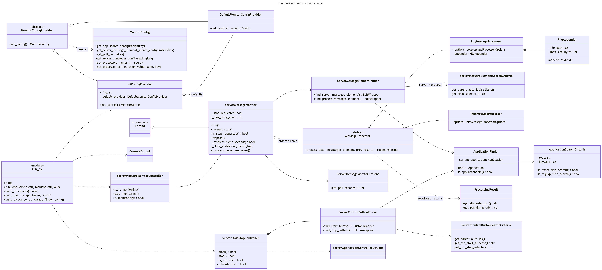

# Ciel.ServerMonitor

Ciel/NextUp Server Log Message Window Monitor Utility.

A small Windows command line utility that keeps the message log windows of the **NextUp ERP server console**
("Administrare Server") from growing without bounds. It periodically trims them, saves what it removes to rotating
log files on disk, and can start or stop the server from the console. It does all this by driving the server's
own user interface with [pywinauto](https://pywinauto.readthedocs.io/), because the server has no API for it.

## Background

Older versions of the NextUp ERP server write every request they receive into a read-only text box
(a DevExpress `MemoEdit`) that is never cleared and never saved to disk. The control's memory use grows much faster than the
text it holds. Under a busy workload (tens of thousands of requests per session, e.g. a data transfer
application) the server became unresponsive after about a day, and so did the whole operating system.

What started as a one-evening prototype that simply cleared the window ended up running in production for about
two years, until NextUp added its own log clearing and file logging. The story is told (in Romanian) here:

- [Crash another day – o utilizare șucară pentru uneltele de testare automată (I)](https://alexboia.net/2025/03/crash-another-day-o-utilizare-sucara-pentru-uneltele-de-testare-automata-i/)

> **Status:** newer NextUp versions clear the window and log to disk on their own, so this tool is no longer needed
> with them. It is kept here as a working example of using UI automation tools for operations, not just for testing.

## Features

- **Finds the server console** by window title (exact or regular expression) and reconnects if the process restarts.
- **Trims the server message log**: when the window holds more than `max_line_count` lines, only the last
  `leave_line_count` lines are kept.
- **Saves the trimmed lines to disk** in log files that rotate by day and by size, so nothing is lost.
- **Clears the secondary process message log** (the *Tasks* tab), which is also a `MemoEdit`, only smaller.
- **Starts and stops the server** by pressing the console's own Start / Stop buttons. The server is started
  automatically if it is not running when the monitor starts.
- **Works with the console minimized or in the background**, by falling back to raw Win32 messages when the
  higher-level pywinauto calls fail.
- **Runs in the background** on its own thread, while the console accepts commands.
- **Configured from an `.ini` file**, with built-in defaults for anything left out.
- **Ships as a single `.exe`** (PyInstaller), so the target machine does not need Python.

## How it works



The diagram source is in [`docs/class-diagram.mmd`](docs/class-diagram.mmd) (Mermaid).

### Main parts

| Area | Classes | Role |
|---|---|---|
| Configuration | `MonitorConfigProvider`, `IniConfigProvider`, `DefaultMonitorConfigProvider`, `MonitorConfig` | Read `config/monitor.ini`; fill in anything missing from the defaults. |
| Finding things | `ApplicationFinder`, `ServerMessageElementFinder`, `ServerControlButtonFinder` and their `*SearchCriteria` | Connect to the console window and locate the log text boxes and the Start / Stop buttons. |
| Processing | `MessageProcessor`, `TrimMessageProcessor`, `LogMessageProcessor`, `ProcessingResult`, `FileAppender` | Trim the log window and write the removed text to rotating files. |
| Monitoring | `ServerMessageMonitor` (a `threading.Thread`), `ServerMessageMonitorController` | Poll loop, retries, clean stop. |
| Server control | `ServerStartStopController` | Start, stop and query the server through its buttons. |
| Entry point | `run.py` | Builds all objects by hand (`build_*` functions) and runs the command loop. |

### The processing chain

On every poll, the monitor runs its processors in order. Each one receives the log text box and the
`ProcessingResult` of the previous one:

1. `TrimMessageProcessor` checks the line count. Above the limit, it keeps the last lines in the window and
   returns the rest as *discarded* text.
2. `LogMessageProcessor` appends only the *discarded* text to the log file.

So every line ends up on disk exactly once, at the moment it leaves the window.

> **Note:** order matters, and it is fixed in `build_processors()` (trim, then log). Running the `log` processor
> without `trim` would append the whole window content on every poll.

A new processor (for example one that parses messages into a database for querying) can be added to the chain
the same way, reading `get_discarded_txt()` from the previous result.

### Finding controls by path

Controls are located by a comma separated path of WinForms control names (`auto_id`), ending with a selector
for the final control. For example:

```ini
server_messages_search_path=tbServer,txtServerMessages,Edit
```

means: in the top window, find `tbServer`, then `txtServerMessages`, then its inner `Edit` control (the actual
Win32 edit box inside the DevExpress `MemoEdit`). The hierarchy was discovered with wfSpy (The Windows Forms Spy
Utility).

A path element can end with `.select` (e.g. `tabPageTasks.select`) to focus it first. This matters for tab pages:
WinForms only creates the controls of a tab page the first time the tab is shown, so the process log does not exist
until its tab has been opened at least once.

### Win32 fallbacks

pywinauto's friendly methods validate the control first (visible, enabled) and simulate user input, which fails when
the console is minimized, in the background, or on another tab. In those cases the monitor talks to the control
directly:

| Action | First try | Fallback |
|---|---|---|
| Replace text | `EditWrapper.set_edit_text()` | `WM_SETTEXT` with a `ctypes` buffer (`helper/set_edit_text.py`) |
| Press a button | `ButtonWrapper.click()` | `BM_CLICK` |

### Server state

The server has no API to report its state, so the monitor reads it from the UI: the server is considered
**started** when the Start button exists and is disabled.

## Requirements

- Windows (the tool uses the pywinauto `win32` backend).
- Python 3.10 (the version used during development) with:
  - `pywinauto`
  - `yachalk`
  - `six`
- For building the executable: `pyinstaller`.

```powershell
python -m pip install pywinauto yachalk six pyinstaller
```

## Configuration

Settings live in `config/monitor.ini`, relative to the working directory. Every value is optional; missing or
empty values fall back to the defaults in `DefaultMonitorConfigProvider`.

```ini
[app_search_config]
type=regexp_title
keyword=(.*)Administrare Server(.*)

[element_search_config]
server_messages_search_path=tbServer,txtServerMessages,Edit
process_messages_search_path=tabPageTasks,txtProcessMessages,Edit

[poll_config]
poll_seconds=1

[server_controller_config]
dir_path=C:\Program Files\NextUp Software\NextUp ERP Complet
parent_auto_ids=FrmWebServicesControlPanel
btn_start_selector=btnStartServer
btn_stop_selector=btnStopServer

[processors_config.trim]
max_line_count=500
leave_line_count=10

[processors_config.log]
destination_dir=./logs
destination_file_name=server-messages-$datetime$-$rindex$.log
rotate_size=1M
```

| Section | Key | Meaning |
|---|---|---|
| `app_search_config` | `type` | `regexp_title` or `exact_title`. |
| | `keyword` | Window title (or title regular expression) of the server console. |
| `element_search_config` | `server_messages_search_path` | Path to the server message log text box (see [Finding controls by path](#finding-controls-by-path)). |
| | `process_messages_search_path` | Path to the process message log text box. This one is simply cleared. |
| `poll_config` | `poll_seconds` | Seconds between polls. Must be greater than 0. |
| `server_controller_config` | `parent_auto_ids` | Path to the window that contains the Start / Stop buttons. |
| | `btn_start_selector`, `btn_stop_selector` | Control name of the Start / Stop buttons. |
| | `dir_path` | NextUp installation folder. Currently not used. |
| `processors_config.trim` | `max_line_count` | Trim when the window holds at least this many lines. |
| | `leave_line_count` | Lines left in the window after trimming. |
| `processors_config.log` | `destination_dir` | Folder for the saved messages. Created if missing. |
| | `destination_file_name` | File name pattern. `$datetime$` becomes the current date (`YYYYMMDD`), `$rindex$` a 4-digit rotation index. |
| | `rotate_size` | Start a new file once the current one reaches this size. Accepts `B`, `K`, `M`, `G` suffixes. |

## Running

1. Open the NextUp ERP server console ("Administrare Server").
2. Start the monitor from the folder that contains `config/` and `logs/`:

   ```powershell
   ciel-server-monitor.exe
   ```

   or, from source:

   ```powershell
   python run.py
   ```

   When running from source, create `logs/runtime/` first; the monitor writes its own diagnostic log to
   `logs/runtime/monitor.log`.

3. While it runs, the console accepts these commands:

| Command | Effect |
|---|---|
| `status-ciel` | Shows whether the server is started or stopped. |
| `start-ciel` | Presses the server's Start button, if the server is stopped. |
| `stop-ciel` | Presses the server's Stop button, if the server is started. |
| `quit` | Stops monitoring and exits. |

`Ctrl+C` also stops monitoring cleanly.

### Output

- `logs/server-messages-YYYYMMDD-NNNN.log`: messages removed from the server log window.
- `logs/runtime/monitor.log`: the monitor's own diagnostic log.

## Building

```powershell
./build.ps1
```

This runs PyInstaller (`--onefile`) and lays out `dist/` with the executable, `config/` and an empty `logs/runtime/`
folder. Copy the whole `dist/` folder to the server machine.

## Known limitations

- Everything depends on the console's UI: window title, control names and tab layout. A NextUp update that renames
  controls breaks the monitor until the configuration is updated.
- Server state is inferred from the Start button; there is no other source.
- Trimming happens between polls, so the window can briefly exceed `max_line_count`.
- There is no automatic restart if the monitor thread itself fails. In practice this was never needed.

## License

[BSD 3-Clause](LICENSE).
